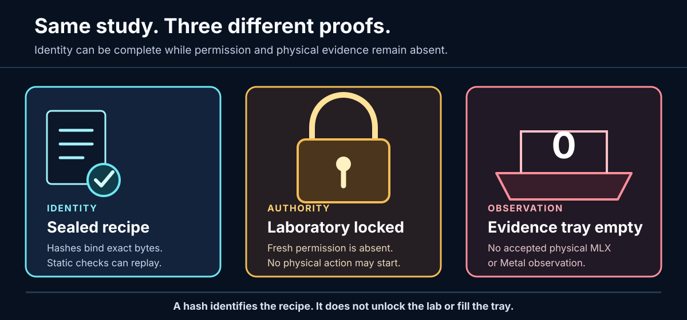
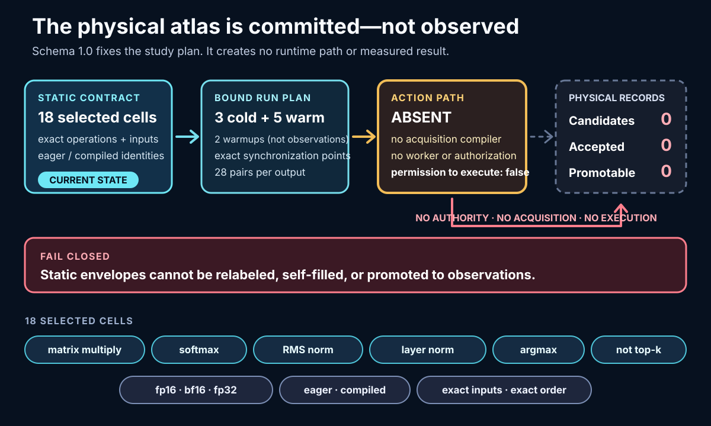

# Is Apple-Silicon AI Deterministic? Measuring MLX Before Loading a Model

> **Prospective study brief.** This article defines a question and a trustworthy way to measure it.
> It reports no physical MLX or Metal result.

**Thesis:** determinism is not a property we can infer from a package version, an Apple chip, a
hash, or one matching output. It has to be measured under predeclared conditions, with every
observation bound to the exact runtime, operation, process, authorization, and comparison rule that
produced it.

<picture>
  <source media="(max-width: 1279px)" srcset="../assets/apple-silicon-determinism/locked-lab-mobile.svg" width="600">
  
</picture>

> [!IMPORTANT]
> **Current state: 0 accepted physical MLX/Metal observations. No permission to run.**
> Static qualification has reached a reviewable decision, but no authorization, runtime import,
> device or Metal query, synchronization, tensor operation, benchmark, or model action is allowed.

## Three questions, not one

These terms are related, but they are not interchangeable:

| Question | What success would mean | What it would not mean |
|---|---|---|
| **Reproducibility** | Another reviewer can reconstruct the same declared bytes, identities, controls, and analysis. | The hardware will return the same bits. |
| **Numerical determinism** | Repeated evaluations under one exact condition satisfy a predeclared equality rule. | The result is authorized, authentic, or representative of another condition. |
| **Trustworthy evidence** | A parent validator accepts an observation whose authority, runtime, process, inputs, outputs, and custody all cross-bind. | The result is numerically equal or scientifically sufficient by itself. |

A SHA-256 digest answers **“which bytes?”** It does not answer **“who allowed this action?”** or
**“what did those bytes do on this machine?”** Hashes are essential identity links, but a
self-asserted chain of perfect hashes can still describe an unauthorized action or an event that
never occurred.

## ELI5: the recipe is checked; the laboratory is still locked

Imagine a school experiment:

1. A teacher seals the recipe and every ingredient. That is **identity**.
2. A safety reviewer checks that the recipe is internally coherent. That is **static
   qualification**.
3. The laboratory door remains locked until a responsible adult gives one-time permission. That is
   **authorization**.
4. A witnessed tray records what actually happened inside. That is **observed evidence**.

Checking the seal does not unlock the door. Unlocking the door does not prove the experiment ran
correctly. An empty tray cannot be described as a successful result.

## The trust progression

LocalInferenceLab deliberately separates four stages:

**1. Exact static qualification.** The canonical publication record
[`sha256:3d789c…711df`](../../evidence/mlx-runtime-qualification-mlx-0.30.4-mlx-lm-0.30.6-macos-arm64-py313-v1.json)
binds the reviewed MLX `0.30.4` / MLX-LM `0.30.6` candidate, target, source anchors, and a
34-artifact wheel closure. It derives `eligible_for_new_observed_authorization` with zero blockers.
That decision means only “eligible for human review toward a possible fresh authorization.”
Offline replay does not prove that the wheel pack is present now.

**2. Explicit authorization.** This does not exist. Runtime-preflight schema-1.0 execution remains
permanently disabled and unreachable. Runtime-preflight schema-1.1 is a process-free contract and
refusal layer: it has no authorization creator or consumer, installer, worker, or execute entry
point.

**3. Bounded execution.** A future implementation would need exact runtime custody, a one-shot
authority, fixed action budgets, no retries, a private worker protocol, strict parent validation,
and terminal process custody. Those requirements are design constraints, not current capability.

**4. Observed evidence.** Nothing physical has been accepted. There is no accepted proof of MLX
import success, native loading, backend or device availability, a positive Metal result, stream
synchronization, tensor behavior, model behavior, or per-kernel Metal dispatch.

The detailed boundaries live in the
[architecture](../architecture.md), [experiment protocol](../protocol.md), and
[direct MLX contract](../mlx-direct-runner-contract.md).

## The legacy 48-cell canary is a map, not a measurement

The historical [runtime-independent determinism canary](../mlx-determinism-canary.md) freezes a
separate 48-cell
Cartesian product:

- eight operation forms: elementwise add, IEEE-edge identity, matrix multiplication, reduction
  sum, softmax, RMS normalization, fused multiply-add, and unfused multiply-add;
- three dtypes: `float32`, `float16`, and `bfloat16`;
- two evaluation styles: explicit and deferred.

All 48 cells remain `unverified_future_support`. Exactly eight cells contain synthetic byte
fixtures; the other 40 are prospective-only.

The eight fixtures **do** establish that the offline machinery can bind operation parameters,
validate tensor metadata, re-derive expected bytes with bounded standard-library arithmetic,
reconstruct comparison metrics, detect identity drift, and replay a closed synthetic bundle.

They **do not** establish MLX support, importability, Apple-silicon behavior, Metal availability,
device placement, execution order, fusion behavior, numerical determinism, performance, or any
physical observation. Determinism-canary schema 1.0 rejects physical and
`authorized_observation` records by design.

## The committed model-free study contract

The committed physical study stops below the model layer. No tokenizer, weights, prompt, cache,
sampling loop, or generated text is needed to ask whether transformer-shaped primitives repeat.
That design is now committed as the process-free
[physical-observation atlas schema 1.0](../mlx-physical-atlas-contract.md). Its exact study ID is
`sha256:231214ab37eea562b70a52639e3bbfd92b6d3cc56a42a026b670c43db8a45d33`.
The schema fixes what a future observer would have to do; it does not observe anything.

<picture>
  <source media="(max-width: 1279px)" srcset="../assets/apple-silicon-determinism/experiment-flow-mobile.svg" width="600">
  
</picture>

| Bound dimension | Committed schema-1.0 contract |
|---|---|
| **18 selected cells** | Matrix multiplication, softmax, RMS normalization, and two-pass layer normalization each bind `float16`, `bfloat16`, and `float32` eager cells plus a `float32` compiled cell. Exact MLX `0.30.4` argmax adds `float32` eager and compiled cells. No cell claims current runtime support. |
| **Argmax, not top-k** | Axis 1, `keepdims=false`, lowest-index tie selection, and native little-endian `uint32` indices are bound. Repeated maxima make the reference inputs tie-heavy. There is no top-k/sort/gather substitute. |
| **Deterministic inputs** | Domain-separated SHA-256 chooses exact finite native-dtype encodings. Shape, row-major layout, payload length, bytes, and digest are identity-bound; generated inputs and reference bytes are not MLX outputs. |
| **Exact run order** | Three fresh cold processes produce one observation each. One fresh warm process then performs two explicitly non-observation warmups followed by five ordered observations. That is eight observations, two warmups, zero retries, and no selective reruns per cell. |
| **Synchronization** | Every planned step binds input materialization before the operation, compiled-operation completion before the first operation when applicable, operation completion before output readback, and output-byte materialization before process advance. Missing or reordered points invalidate the envelope. |
| **28 comparisons per output** | All three cold/cold pairs, all ten warm/warm pairs, and all 15 cold/warm pairs are required in class-major lexicographic order. Missing, duplicate, reordered, or favorable-subset records fail closed. |
| **Metrics** | Floating outputs bind exact payload equality, native mismatch count, maximum absolute and relative error, RMS error, signed-zero-normalized native ULP distance, and finite/NaN/infinity/signed-zero/special counts. Argmax uses exact `uint32` element comparison only. |

Every committed envelope is `static_specification` / `prospective_unobserved`. Runs, metrics,
physical provenance, and custody are empty. Current counts are **0 physical candidates, 0 accepted
physical observations, and 0 promotable records**; `permission_to_execute=false`.

There is no acquisition compiler, worker, authoritative authorization, execution permission, or
measured result. The offline surface can compile, inspect, verify, and replay the static contract,
but it has no execute, observe, authorize, runtime-probe, device-query, Metal-query, or synchronize
command. Timing remains forbidden. Even a future accepted device string or
`metal.is_available()` value would not prove that each kernel used Metal.

## The hard stop and the refusal rules

**Fresh human authorization is required after the static declaration and qualification are
reviewed, and before any authorization artifact may be created or any physical action begins.**
A future worker could consume that one-shot authority only after its exact identity and custody
bindings pass validation, and before its first allowed import, device query, synchronization, or
tensor operation. The repository cannot perform that transition today.

The future study must fail closed when any of these is true:

- the qualification, runtime, operation, case, process, output-root, nonce, or authorization
  identity is missing or drifts;
- authority is absent, stale, reused, caller-self-attested, or not independently custody-bound;
- a dtype, primitive, eager/compiled path, or device condition was not predeclared and proven
  eligible;
- a worker attempts an install, network action, model/tokenizer action, benchmark, retry, or other
  forbidden action;
- output dtype, shape, byte order, length, process identity, synchronization state, or retained
  repeat count does not match;
- a failed observation is dropped, replaced, or selectively rerun; or
- parent validation cannot distinguish attempted actions, completed actions, and accepted
  evidence.

Refusal is not a failed publication. It is the mechanism that keeps a prospective study from
quietly becoming a claim.

## What can be said today

The project has an exact static candidate, a zero-blocker qualification decision, a rigorous
comparison vocabulary, and synthetic fixtures that test that vocabulary. It has **zero accepted
physical MLX/Metal observations and no permission to run**.

That is enough to design the experiment honestly. It is not enough to answer the title.

For the canonical specifications rather than this narrative, read the
[legacy canary contract](../mlx-determinism-canary.md),
[physical atlas contract](../mlx-physical-atlas-contract.md),
[schema-1.1 protocol](../protocol.md#prospective-schema-11-model-free-runtime-preflight-protocol),
[current source boundaries](current-sources.md), and
[static preparation runbook](../runbooks/mlx-prospective-study.md).
