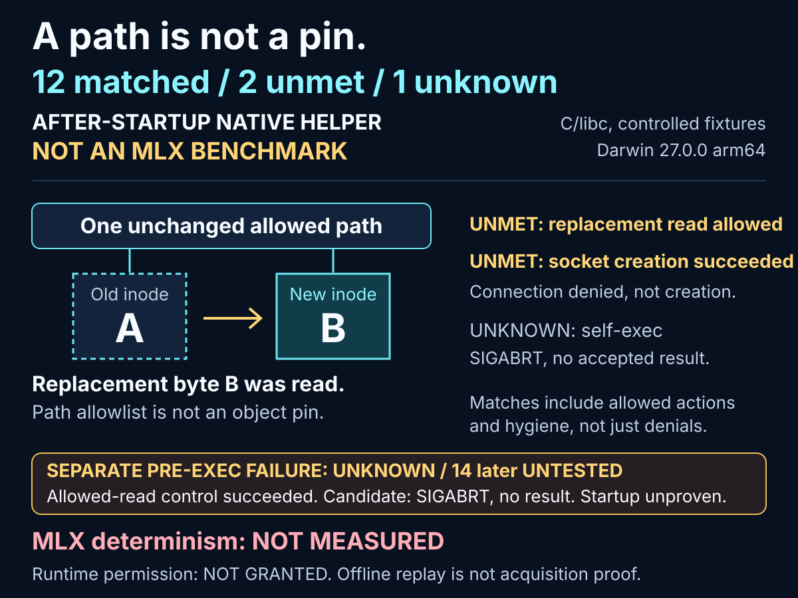

# A path is not a pin: what my macOS probe actually measured

**12 matched / 2 unmet / 1 unknown. After-startup native helper, not an MLX benchmark.**

<picture>
  <source media="(max-width: 1279px)" srcset="native-evidence-card-mobile.svg" width="600">
  
</picture>

Before measuring local AI determinism, I tested a narrow macOS policy.
An allowed filename stayed the same while its underlying object changed.

## ELI5: the address stayed; the parcel changed

Imagine a guard checking a locker address, not the parcel inside. Replace the parcel:
the address still matches.

The initial allowed read returned byte **A**.
The parent atomically replaced that owned fixture pathname with a different inode containing
byte **B**. Under the unchanged path policy, the native helper read **B**.
An inode identifies an object; observing it does not enforce a pin.

This is not a hostile-parent attack or race test. "Allow this path" and "read these exact bytes
for the entire process lifetime" differ; other pathname policies may behave differently.

## What actually ran

A hand-written C/libc helper exercised owned files, loopback sockets, fork/exec and hygiene
on Darwin 27.0.0 arm64. **Synthetic fixture** means deliberately chosen input bytes and paths.
**Retained native outcome** means actual helper results and parent-observed failures,
not invented success fixtures.

The pre-exec deny-default Seatbelt candidate aborted without output; its allowed-read control
succeeded. That left
**1 unknown calibration and
14 later checks untested**. It is not proof that macOS
cannot enforce controls.

A separate diagnostic applied the same profile after helper startup, adding no grants.
It measures an already-running helper, not startup confinement or actual MLX enforcement.

## Every after-startup result

All baseline controls succeeded. "Matched" includes intended allowances, not just denied
actions. The aggregate remains `refused`.

| Check (required) | Candidate result |
|---|---|
| Allowed read (allow) | **MATCHED**<br>Succeeded; byte A |
| Allowed write (allow) | **MATCHED**<br>Succeeded |
| Outside-list read (deny) | **MATCHED**<br>Denied (errno 1, EPERM) |
| Outside-list write (deny) | **MATCHED**<br>Denied (errno 1, EPERM) |
| Prefix-sibling read (deny) | **MATCHED**<br>Denied (errno 1, EPERM) |
| Symlink read (deny) | **MATCHED**<br>Denied (errno 1, EPERM) |
| Symlink write (deny) | **MATCHED**<br>Denied (errno 1, EPERM) |
| Socket creation (deny) | **UNMET**<br>Succeeded |
| Loopback connection (deny) | **MATCHED**<br>Denied (errno 1, EPERM) |
| Fork (deny) | **MATCHED**<br>Denied (errno 1, EPERM) |
| Other executable (deny) | **MATCHED**<br>Denied (errno 1, EPERM) |
| Self-exec (deny) | **UNKNOWN**<br>SIGABRT; no result |
| Descriptor hygiene (allow) | **MATCHED**<br>Succeeded |
| Environment hygiene (allow) | **MATCHED**<br>Succeeded |
| Replacement read (deny) | **UNMET**<br>Succeeded; byte B |

**Socket creation succeeded; loopback connection was denied.** `connect()` is not `socket()`.
Self-exec's SIGABRT leaves effects unknown, not proven denied.
Descriptor hygiene covered 3..255, not supplied standard streams.
Empty environment/closed extra descriptors are parent hygiene, not resource revocation.

## What you can reuse now

Reuse this requirements checklist: paths versus objects, acquisition versus connection,
completed denials versus crashes. Keep the negative and unknown rows.

The exporter checks pinned bytes/identities, reuses canonical/native validators, and derives
counts/tables/visuals together. Caller-rehashed mutations cannot publish.
Regenerate without MLX:

```bash
# From the repository root, with Python 3.12+; no install or MLX needed.
PYTHONPATH=src python3 -m localinferencelab.native_evidence_card \
  --pre-exec docs/evidence/native-confinement-darwin-27.0.0-arm64-v1.json \
  --after-startup docs/evidence/native-confinement-after-startup-darwin-27.0.0-arm64-v1.json \
  --output-dir /tmp/localinferencelab-native-card
```

Fresh-directory outputs: `native-evidence-card.json`, `native-evidence-card.md`,
desktop/mobile `native-evidence-card*.svg`, and this article.
Installed wheel: omit `PYTHONPATH=src`,
use its Python, and supply explicit original receipt paths; they are not bundled.
The [reproduction contract](native-evidence-card.md#reproduce-the-publication-not-the-os-experiment)
specifies byte comparison and errors.

## What this does not buy us

**MLX determinism: NOT MEASURED. Runtime authority and physical approval remain false;
production bindings remain null.** No model latency, lower inference cost or GPU performance
was measured. A historical model-free MLX attempt did occur and failed; these results
do not erase it or yield accepted MLX evidence. The atlas stays unobserved.

The helper cannot exclude internal native math/tensor/cache work. Loader grants are not an exact
native closure. Deprecated Seatbelt, unconfined startup, permitted sockets, re-exec uncertainty
and trusted-parent limits remain.
Integrity-only offline replay does not authenticate original OS acquisition.

[Pre-exec receipt](https://github.com/Siddhant-K-code/LocalInferenceLab/blob/2accb11d14a56222e36c8b61957ce56031ff04f7/docs/evidence/native-confinement-darwin-27.0.0-arm64-v1.json) and
[after-startup receipt](https://github.com/Siddhant-K-code/LocalInferenceLab/blob/2accb11d14a56222e36c8b61957ce56031ff04f7/docs/evidence/native-confinement-after-startup-darwin-27.0.0-arm64-v1.json) retain full
identities.
The [disclosure](https://github.com/Siddhant-K-code/LocalInferenceLab/blob/2accb11d14a56222e36c8b61957ce56031ff04f7/docs/native-confinement-feasibility.md) distinguishes historical acquired producers from current
corrected offline-derived sources: unchanged receipts, no reacquisition.
Host observations do not amend the frozen runtime target. No permission is added.

## Ready-to-share X drafts

Copy each draft without its numbering. No post has been sent.

1. A path is not a pin. My after-startup macOS C/libc probe read byte B from a new inode at the same allowed pathname. Not an MLX determinism result.

2. Actual native-helper results: 12 matched / 2 unmet / 1 unknown. Matched includes allowed actions and hygiene, not just denials. After-startup policy, not startup confinement or an MLX benchmark.

3. Blocked connect() is not blocked socket(). My retained after-startup helper created a socket but could not connect to loopback. Test the exact action, not a proxy.

4. Pre-exec: allowed-read control worked; candidate aborted with no result. 14 later checks untested. Not proof macOS cannot enforce controls. MLX runtime permission stays absent.

5. Reuse two pinned public receipts: deterministic JSON, Markdown and SVG with standard-library Python. No new probe or MLX. Offline replay checks integrity, not authenticity of the original OS acquisition.
